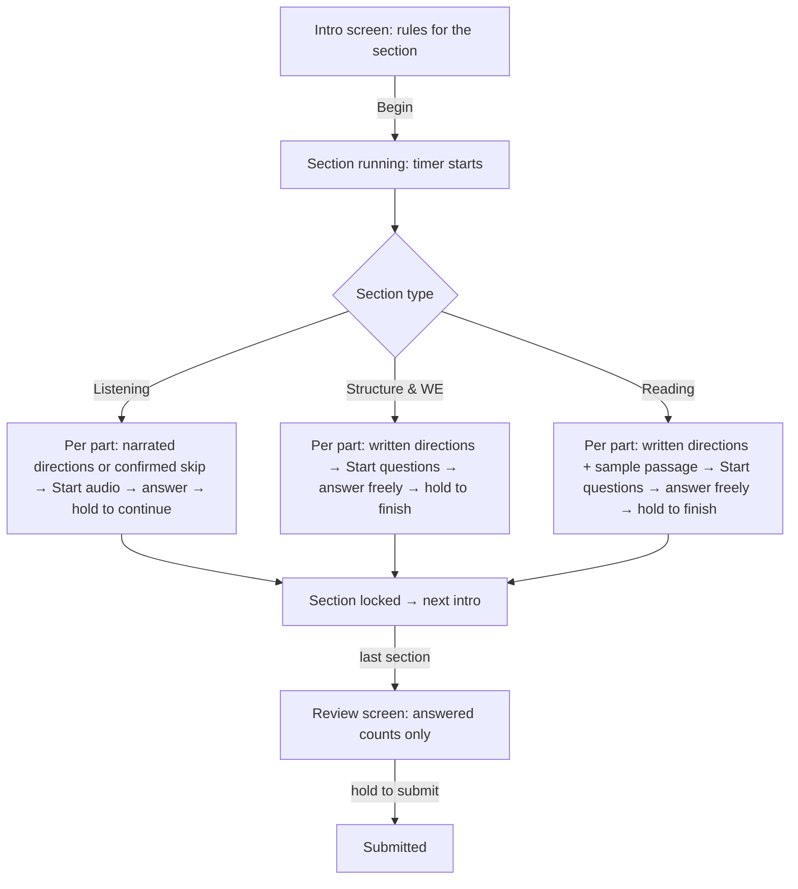
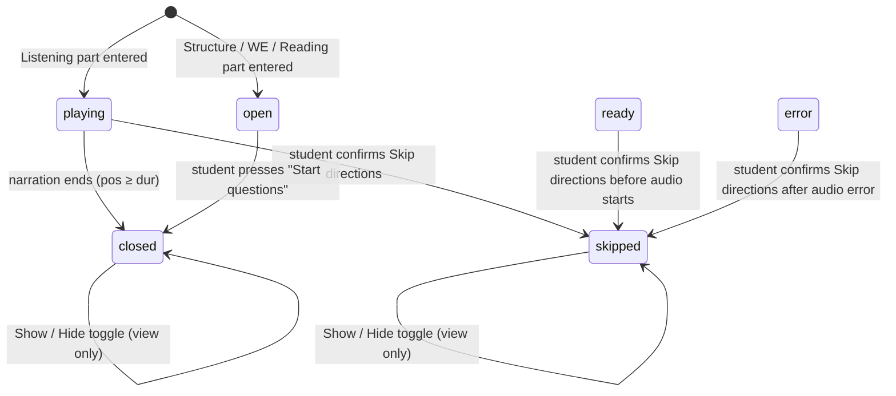
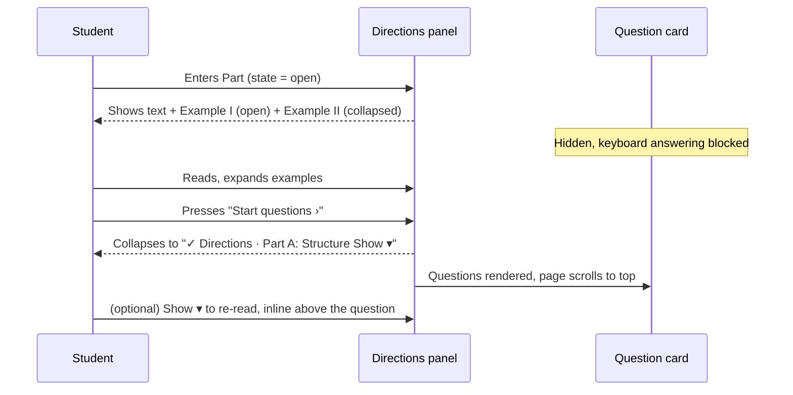

# QuickCheck TOEFL ITP Mock Test — Directions System

Detailed specification of how **directions** work across the three sections (Listening, Structure & Written Expression, Reading): features, logic, flow, UI/UX/HCI rationale, and expected behavior.

> **Implementation note:** Listening directions in the live Section 1 page use the original recording, with per-part cutoffs: 2:19 for Part A, 0:36 for Part B, and 2:48 for Part C. The prototype snippets below describe the design model; current skip behavior is documented in §5.1. Items marked **[DECISION]** are assumptions that product should confirm.

---

## 1. Purpose and scope

In a real TOEFL ITP, every section and part opens with directions plus worked examples. In the paper test these are read (or heard) before the questions. The on-screen mock test must reproduce that experience while fixing what paper cannot: orientation, waiting time, accessibility, and accidental loss of progress.

This document covers:

- what the student sees and can do during directions in each section,
- the rules (what is locked, what is allowed),
- the state machine and data model behind it,
- the cross-cutting UX decisions (collapse, text size, follow-along, announcements),
- acceptance criteria and a QA checklist.

Out of scope: scoring, results screens, authentication, and the question bank.

---

## 2. Design principles

| # | Principle | Consequence in the UI |
|---|---|---|
| 1 | **Sections and parts are one-way.** | Once a section or Listening part is left, it is locked. Only answered counts remain visible. |
| 2 | **Directions come first, questions are gated.** | Questions for a part stay hidden until its directions are done. |
| 3 | **Never leave the student guessing.** | Every wait has an explanation (locked placeholder, step tracker, status chip, time left). |
| 4 | **The student stays in control of reading, not of audio.** | Narration is not paused or replayed; students can deliberately skip it after a clear confirmation. Text can always be re-read, resized and scrolled. |
| 5 | **Irreversible actions need deliberate input.** | Continue/Finish use press-and-hold (≈1.1 s). |
| 6 | **Directions get out of the way.** | They auto-collapse to one row when done and can be reopened inline, never as a blocking modal. |
| 7 | **Same visual language everywhere.** | Option cards in directions look exactly like option cards in questions. |

---

## 3. End-to-end test flow



Section order is fixed: **Listening → Structure & Written Expression → Reading**. Finished sections show `N/M answered · locked` in the top stepper and can never be reopened.

---

## 4. Shared model

### 4.1 Where directions live in the data

Each part carries a directions object `d`:

```js
part = {
  name: "Part A", title: "Short conversations",
  d: DIR.LA,          // directions object (below)
  audio: 60,          // Listening only: question-audio length in seconds
  passage: [...],     // Reading only
  qs: [ Q(text, [opt, opt, opt, opt]), ... ]
}

DIR.X = {
  dur: 50,            // Listening only: narration length in seconds (presence = narrated)
  t:   [ ... ],       // transcript / written text (see 4.2)
  ex:  [ ... ]        // Structure/WE/Reading only: worked examples (see 4.3)
}
```

### 4.2 `t` — transcript / written text

- **Written sections:** array of HTML strings (supports `<b>`, `<u>`, `<sub>`).
- **Listening:** array of items, each either
  - a **string** → rendered as a paragraph, split into sentences for highlighting, or
  - an **option block** `{ o: [4 options], a?: index }` → rendered as four option cards; if `a` is present, that card is the **sample answer** (green).

Placeholders resolved at render time:

| Token | Meaning | Example |
|---|---|---|
| `{r}` | question range of the *current part* | `Questions 1–15` |
| `{s}` | question range of the *whole section* | `For questions 1–50` |

Ranges are computed from the loaded data, so directions never contradict the actual question count.

### 4.3 `ex` — worked examples

```js
{ l: "Example I", a: 1, b: "sentence or question", pre: "optional sample passage",
  c: ["opt A", "opt B", "opt C", "opt D"], e: "explanation text" }
```

Rendered as a collapsible card: label + "sample answer X", optional serif passage block, the question, four option rows with the correct one marked ✓, and the explanation.

### 4.4 Per-part directions state

State key = `sectionIndex + part.name` (so "Part A" in Listening and "Part A" in Structure never collide).

```js
dr[key] = { st, pos, show, hid, free, fresh }
```

| Field | Meaning |
|---|---|
| `st` | `"playing"` (narration running), `"open"` (written, waiting for Start), `"closed"` (heard/read to completion), `"skipped"` (student confirmed the Listening skip) |
| `pos` | seconds of narration elapsed (Listening) |
| `show` | user expanded the collapsed panel |
| `hid` | user hid the panel while narration is playing |
| `free` | user scrolled the transcript manually, so auto-follow is paused |
| `fresh` | directions just finished, so play the unlock animation once |

Initial state: `st = "playing"` if the part has `d.dur`, otherwise `"open"`.
**Gate rule:** `directions active = (st !== "closed" && st !== "skipped")`. While active, the part's questions are not rendered and answering by keyboard is blocked.

### 4.5 State machine



There is no transition back to `playing` or `open`. Reopening a closed or skipped panel only reveals text; it never re-gates the questions or restarts directions audio.

---

## 5. Listening directions

### 5.1 Rules

1. Narrated directions start automatically when a part begins. They cannot be paused, scrubbed or replayed. A **Skip directions** control opens an inline confirmation that explains the consequence; the student must confirm again to proceed.
2. Confirming the skip pauses the original recording, seeks to that part's cutoff (2:19 / 139 seconds for Part A; 0:36 / 36 seconds for Part B; 2:48 / 168 seconds for Part C), collapses the directions and unlocks the current part. The status reads **Skipped**, not **Heard**. Cancel or Escape leaves the directions unskipped and the questions locked; playback continues if it was active.
3. Questions of the part stay locked until the narration ends or the student confirms the skip.
4. After directions, the conversation/talk audio is started by the student with **Start audio**. It also plays once with no pause or replay.
5. All questions of the part are shown together. Answers can be changed until the student continues to the next part.
6. Continuing to the next part locks the current part permanently.

### 5.2 Per-part content

| Part | Narration includes | Sample question(s) in directions | Original audio gate |
|---|---|---|---|
| **A** | Section 1 introduction **plus** Part A directions | 1 (painting) with green sample answer | 0:00–2:19 (139 s) |
| **B** | Part B directions only | none | 0:00–0:36 (36 s) |
| **C** | Part C directions + example talk | 2 (TV programme) with green sample answers | 0:00–2:48 (168 s) |

Each part starts its original recording at 0:00 and gates questions until its part-specific cutoff unless the student confirms the skip. Skipping moves the same original recording to that cutoff before section audio can start; the transcript shown remains specific to the active part. Part A deliberately merges the section introduction and Part A directions because the source recording is one continuous track.

### 5.3 Screen anatomy (top to bottom)

```
┌───────────────────────────────────────────────┐
│ AUDIO CARD (navy)                             │
│  Part A: Short conversations   [Directions › Listen & answer › Continue]
│  ▂▅▇▅▂▃▆▇▅▂ waveform (animates only while audio plays)
│  ━━━━━━━●────── progress (not draggable)       │
│  "Playing directions…" (status, centered)      │
│  12s left                                      │
│  [▶ Start audio]  (only when question audio is ready)
│  Plays once. No pause, no replay.              │
├───────────────────────────────────────────────┤  ← attached, no gap
│ DIRECTIONS PANEL (white)                       │
│  Directions │ Part A: …    ● Playing  Hide directions ˄
│  [A−][A+]                                      │
│  transcript (serif, scrollable, ≤38vh)         │
│     highlighted current sentence               │
│     option cards (dimmed until reached)        │
│                         [↓ Follow along]       │
└───────────────────────────────────────────────┘
 LOCKED PLACEHOLDER  (while directions play)
   "🔒 Questions 1–2 are locked while the directions play" + skip action + shimmer lines
   [Skip directions] → inline warning → [Keep listening] / [Skip and unlock questions]
 — or, after directions / confirmed skip —
 QUESTION CARDS (all questions of the part) + sticky footer
```

The audio card and the directions panel form **one visual unit**: the audio card has rounded top corners, the panel has rounded bottom corners, and there is no gap, so it reads as "the audio and its script".

### 5.4 Step tracker (orientation)

Three pills on the audio card show the phase:

| Pill | Active when | Done (✓) when |
|---|---|---|
| **Directions** | narration playing | narration finished |
| **Listen & answer** | narration finished and question audio not finished | question audio finished |
| **Continue** | question audio finished | — |

### 5.5 Karaoke-style transcript

- Text is split into sentences (on `. ? ! ”` followed by whitespace).
- The active sentence is chosen by **elapsed fraction × total characters**. It gets a tinted background; sentences not yet reached are greyed.
- Option blocks that come **after** the current sentence are dimmed to 35% opacity. As narration reaches them they fade in, and the **green sample answer appears when the narrator says it**.
- After narration ends, everything is fully visible (no dimming) if the student reopens the panel.

**[INTEGRATE]** The prototype estimates position by character count. In production, use per-sentence cue timestamps from the recording (or the audio element's `timeupdate`) to avoid drift.

### 5.6 Interaction details

| Control | Behavior |
|---|---|
| **Hide / Show directions** | Entire header row is the button (≥56 px tall). While playing it toggles `hid`; after finishing it toggles `show`. Narration continues regardless. |
| **Auto-scroll** | The transcript scrolls so the active sentence sits about one-third from the top. |
| **Follow along** | Mouse wheel, touch or click inside the transcript sets `free = true`: auto-scroll stops and a **↓ Follow along** pill appears. Pressing it resumes tracking. `free` resets when directions end. |
| **A− / A+** | Transcript font size 14–24 px, default 17. Saved in `localStorage` (`qc-fz`). |
| **Status chip** | `● Playing` (pulsing) while narrating, `✓ Heard` afterwards. |

### 5.7 Hand-off when narration ends

1. `st` becomes `closed`, `fresh` is set.
2. A polite screen-reader announcement is issued: *"Directions finished. Questions are unlocked. Press Start audio when you are ready."*
3. The panel collapses to its header row (**Show directions ˅**).
4. The page scrolls to the top so **Start audio** is visible.
5. The question cards and footer rise in (staggered, once only).

If the student confirms **Skip directions**, `st` becomes `skipped` instead: the original audio pauses at that part's cutoff (2:19 for Part A; 0:36 for Part B; 2:48 for Part C), the directions collapse, questions unlock, and the status remains visibly distinct from **Heard**. Focus moves to the section audio control so keyboard users can continue.

### 5.8 Question audio and answering

- Before **Start audio**: option inputs are disabled; the status reads *"Ready — press Start audio"*.
- After start: waveform animates, progress runs, *"Playing…"*, time left shown. Questions are answerable while the audio plays.
- Audio finished: status *"Audio finished"*, step 3 (Continue) becomes active, and the footer button enables.

### 5.9 Footer (sticky) and locking

- Hint text: *"Wait for the audio to end before continuing."* → then *"N unanswered in this part. Continuing locks this part."*
- Button: **Hold to continue to Part B** (or **Hold to finish Listening** on the last part). It is disabled until the audio has finished. Holding fills the button over ≈1.1 s; releasing early cancels.
- Navigator: tiles of the current part scroll smoothly to their card (with a brief flash); tiles of other parts are dimmed and disabled.

---

## 6. Structure & Written Expression directions

### 6.1 Rules

1. Directions are **written** (no narration) and read at the student's own pace.
2. Questions of that part remain hidden until the student presses **Start questions**.
3. Each part has its own directions: **Part A Structure**, **Part B Written Expression**. Part B's directions appear again the first time Part B is entered.
4. After Start, students move freely between questions in the section (Previous/Next, navigator, flags) until they finish the section.
5. Directions can be reopened at any time as an inline panel.

### 6.2 Content

| Part | Text | Examples |
|---|---|---|
| **A – Structure** | Time 25 minutes; two question types; incomplete sentences `{r}`, choose the **one** word/phrase | Example I (because), Example II (there was hardly) |
| **B – Written Expression** | Four underlined parts marked A–D, identify the **one** that must change `{r}` | Example I (call → called), Example II (term → terms) |

Underlined words use `<u>` with a small subscript letter (`<sub>A</sub>`) so students see the A/B/C/D mapping, exactly as on paper.

### 6.3 Screen flow



### 6.4 Panel anatomy

- **Open:** title `Directions · Part A: Structure`, chip *Read at your own pace*, paragraphs, example cards, footer row with *"Your section timer is running."* and **Start questions ›**.
- **Closed:** single slim bar with ✓, title and Show/Hide toggle. It slides in when it appears, and re-expansion shows paragraphs and examples without hiding the question.

### 6.5 Timer **[DECISION]**

The section timer starts at **Begin** and keeps running while the student reads directions. The Begin screen and the panel both say so. If the product decision is "timer starts after Start questions", only the tick condition needs to change.

---

## 7. Reading directions

### 7.1 Rules

Same gating and collapse behavior as Structure & WE (written, **Start questions**, reopenable), plus:

- The directions include a **sample passage** (serif, left border) followed by **Example I** with the question, four options and the green ✓ answer.
- The section statement *"Time: 55 minutes"* and *"For questions `{s}`"* (full section range) are shown.
- The emphasized words **stated** and **implied** are bold, as in the source.

### 7.2 After Start

- Layout becomes split-pane: **passage on the left (sticky, scrollable)**, **question card on the right**.
- Directions remain available above the split as the collapsed bar. Re-opening shows the sample passage and example inline.
- Students move freely between questions and flag for review until they finish the section.

### 7.3 Mobile

The split collapses to a single column (passage above, question below).

---

## 8. Side-by-side comparison

| Aspect | Listening | Structure & WE | Reading |
|---|---|---|---|
| Delivery | Narrated + live transcript | Written | Written |
| Starts | Automatically | Student presses **Start questions** | Student presses **Start questions** |
| Can student skip? | Yes, after inline confirmation | Yes (by Start) | Yes (by Start) |
| Can student replay audio? | No | n/a | n/a |
| Collapse trigger | Narration ends | Start pressed | Start pressed |
| Reopen later | Yes (inline) | Yes (inline) | Yes (inline) |
| Examples | Option cards inside transcript (green answer) | Collapsible example cards with ✓ | Sample passage + example card with ✓ |
| Wait explanation | Locked placeholder + step tracker | Not needed (self-paced) | Not needed (self-paced) |
| Gate scope | Per part | Per part | Per part |
| Navigation after | Within current part only | Free within section | Free within section |
| Leave control | Hold to continue/finish | Hold to finish (last question) | Hold to finish (last question) |

---

## 9. Cross-cutting UX / HCI decisions

| Topic | Decision | Reason |
|---|---|---|
| **Collapse, not close** | Directions become a one-row bar, never a modal or a disappearing element. | The student keeps spatial memory and can reread. |
| **Auto-follow with escape** | Auto-scroll pauses on manual scroll and offers *Follow along*. | Avoids the "scroll fight" where the page fights the user. |
| **Text size control** | A−/A+ with persistence. | Accessibility without browser zoom breaking layout. |
| **Status in words, not just color** | `Playing` / `Heard`, step labels, ✓ marks, "Sample answer ✓". | Do not rely on color alone. |
| **Locked placeholder** | Explains *why* questions are missing. | Prevents "is it broken?" and reduces perceived wait. |
| **Hold-to-confirm** | Continue, Finish and Submit require ≈1.1 s hold; keyboard Space/Enter held works. | Protects irreversible actions without popups. |
| **No scrubbing UI** | The progress knob is decorative (non-interactive). | Matches the no-seek rule. |
| **Consistent option cards** | Same component in directions and questions. | Zero learning cost. |
| **Reduced motion** | All animations and transitions are disabled under `prefers-reduced-motion`. Behavior is unchanged. | Vestibular safety. |
| **Dark mode** | Tokens swap under `prefers-color-scheme: dark`. The navy audio card stays navy in both modes. | Readability. |

### 9.1 Accessibility

- A persistent `aria-live="polite"` region announces when directions finish.
- Toggle buttons expose `aria-expanded`. The transcript region has a label and is focusable (`tabindex="0"`).
- The step tracker has an `aria-label`. Part/section chips have descriptive `aria-label`s.
- All controls have visible `:focus-visible` outlines. Touch targets are ≥ 40–44 px.
- Option inputs are real radio inputs wrapped in labels.

### 9.2 Keyboard

| Key | Action |
|---|---|
| `A`–`D` | Answer the current question (blocked while directions are active, or before Start audio) |
| `←` / `→` | Previous / next question (Structure, WE, Reading) |
| `F` | Flag for review (not in Listening) |
| `N` | Collapse/expand the question navigator |
| `Esc` | Close the mobile question sheet |
| `Space`/`Enter` (held) | Fills hold-to-confirm buttons |

### 9.3 Mobile (≤ 860 px)

- Keep the exam at native viewport size; do not shrink the 1438px desktop frame to fit a phone. Audio and directions cards use the available width and remain attached.
- Navigator becomes a slim **bottom dock** (`Q3/15 · Part A · 12 left ▲` + **↓ Next open**) that opens a pull-up sheet.
- Transcript keeps its own scroll area. Follow-along works the same.
- Previous/Flag/Next stay sticky at the bottom of the question card (Structure, WE, Reading).

---

## 10. Interaction with the rest of the app

### 10.1 Section timer

- Runs from **Begin** until the section ends (all section types).
- Directions time counts against it **[DECISION]**.
- At 0:00 the section finishes automatically, even mid-directions. Turns red and pulses under 5 minutes.

### 10.2 Navigator / rail

- **During Listening directions:** rail visible, tiles of the current part clickable, but questions are not yet rendered. Clicking a tile has no visible target until unlock.
- **During written directions:** tiles are clickable, and selecting a tile in a gated part still shows that part's directions.
- Collapsed rail shows ring (questions left), part chips, current question, *Next open*, *Flagged*.

### 10.3 Top stepper

Shows `Question n of N` for the current section, `N/M answered · locked` for finished sections, and `Not started` for upcoming ones. No section can be clicked.

---

## 11. Expected behavior (acceptance criteria)

### Listening
- [ ] Entering a part starts narration automatically (after a user gesture; see §13).
- [ ] The transcript highlights the sentence being spoken and scrolls to follow it.
- [ ] Option blocks ahead of the narration are dimmed. The green answer appears when reached.
- [ ] Manual scroll pauses follow; **Follow along** resumes it.
- [ ] Hide/Show works during and after narration without affecting audio.
- [ ] Questions do not render until narration ends or the student confirms the inline skip. A locked placeholder is shown meanwhile.
- [ ] On end: panel collapses, page scrolls to top, cards rise in, screen reader announces.
- [ ] Skip requires a second confirmation that names the consequence; cancel and Escape return to listening without unlocking questions.
- [ ] Confirmed skip pauses/seeks the original recording to the active part's cutoff (2:19 for A; 0:36 for B; 2:48 for C), collapses directions, unlocks questions, and announces **Skipped** rather than **Heard**.
- [ ] After confirmation, keyboard focus moves to the section audio control; the skip buttons do not lose focus while the directions continue during confirmation.
- [ ] Skipping while audio is still loading still seeks to the active part's cutoff when metadata becomes available; starting section audio does not replay the directions.
- [ ] Options stay disabled until **Start audio** is pressed.
- [ ] Question audio cannot be paused or replayed. Footer button enables only when it ends.
- [ ] Holding the footer button ≈1.1 s moves to the next part. Earlier parts become non-clickable.
- [ ] A−/A+ changes transcript size and persists across reloads.

### Structure & Written Expression
- [ ] Each part shows its own directions first. Questions hidden until **Start questions**.
- [ ] Example I is open by default, others collapsed. Correct option is marked ✓.
- [ ] After Start, the bar reads "✓ Directions · …" and can be reopened inline.
- [ ] Keyboard answering is blocked until Start.

### Reading
- [ ] Directions include time (55 min), section range and the sample passage + Example I with ✓ answer.
- [ ] After Start: passage left (sticky), question right. Directions remain reopenable.

### General
- [ ] The section timer keeps running through directions and auto-finishes at 0:00.
- [ ] Reduced-motion users see no animation but identical function.
- [ ] Layout works from 360 px to desktop in light and dark mode.

---

## 12. Edge cases

| Case | Expected handling |
|---|---|
| Student scrolls transcript up mid-narration | Follow pauses, button appears. Narration and gating unaffected. |
| Student hides directions while playing | Narration continues, chip stays **● Playing**, questions stay locked, and the placeholder still explains why. |
| Section timer ends during directions | Section finishes, next intro screen shows (answered count may be 0). |
| Student jumps (via navigator) to Part B in Structure before Start in Part A | Part B directions show for Part B. Part A remains gated separately. |
| Window resized across the 860 px breakpoint | Layout switches between rail and dock. State is preserved. |
| Reopening directions after finish | Full text visible, no dimming, no re-gating, no audio restart. |
| Text-size buttons pressed repeatedly | Clamped to 14–24 px. |
| localStorage unavailable | Falls back to defaults. No errors. |

---

## 13. Integration notes **[INTEGRATE]**

1. **Original audio (implemented).** Listening directions and question playback use the original `HTMLAudioElement`; `timeupdate` tracks the active part's cutoff (139 seconds for Part A; 36 seconds for Part B; 168 seconds for Part C).
2. **Autoplay policy.** Browsers require a user gesture before audio. Directions for Part A start after the **Begin** click (a gesture). Directions for Parts B/C start after a **hold-to-continue** release, which is *not guaranteed* to count as a gesture. Provide a fallback: if `play()` rejects, show a **Tap to start directions** button in the audio card and keep the same state machine.
3. **Sentence timing.** Provide cue timestamps per sentence instead of the character-count estimate.
4. **Durations.** The Listening directions gate uses per-part cutoffs (139 seconds for Part A; 36 seconds for Part B; 168 seconds for Part C); question playback continues from that point using the source track's actual duration.
5. **Persistence.** State is in memory. Production needs server-side progress (current section/part, directions state, elapsed time) so a refresh or crash can resume without granting a replay.
6. **Narration wording.** The recordings say "test book" and "answer sheet". The transcript is faithful to the audio, which may confuse on-screen test takers. Either re-record or add a short note.
7. **Data source.** Directions text was transcribed from the provided PDFs (Part A/B/C narrations; Structure, Written Expression and Reading directions). Keep a single source of truth in `DIR` and fill `{r}`/`{s}` from the real question counts.

---

## 14. Known limitations and risks

- **Browser support:** sentence splitting uses a regex look-behind, and the green card uses `color-mix()`. Both need modern browsers (Safari ≥ 16.4 / current Chrome, Edge, Firefox). Provide a fallback splitter and solid colors if older browsers matter.
- **Highlight drift:** estimated by characters, so it can run slightly ahead or behind real speech until cue timestamps are used.
- **Not verified in a browser by this document's author.** Run the QA checklist (§11) on desktop and a real phone before release.
- **Timer policy** (§6.5) is an assumption.
- **Sample content** only: three Listening parts, two Structure/WE parts, one Reading part with a few questions each.

---

## 15. Reference: key implementation names

| Name | Role |
|---|---|
| `DIR` | All directions content (transcripts, examples, durations) |
| `dr[key]`, `dirSt(x)`, `dirActive(x)` | Per-part directions state and gate |
| `fill(t, x)` | Resolves `{r}` / `{s}` |
| `dirHTML(x)` | Renders **written** directions (open/closed bar) for Structure, WE, Reading |
| `renderListening(x, …)` | Renders the Listening unit: audio card, directions panel, locked placeholder, question cards, footer |
| `updDir(x)` | Per-second update: progress bar, time left, sentence highlight, option-block dimming, auto-scroll |
| `bindDir(x)` | Wires Start questions, Show/Hide, text size, Follow along |
| `hold(el, ms, cb)` | Press-and-hold confirmation |
| `announce(text)` | Screen-reader live announcement |
| `fz`, `qc-fz`, `qc-rail` | Text size and rail-collapse preferences (localStorage) |

---

## 16. One-paragraph summary

Every part opens with directions that match its medium. Listening plays narrated directions with a live, resizable transcript attached under the audio card, reveals sample answers in sync with the speech, and explains the wait with a locked-questions placeholder. Students may skip the spoken directions after an inline confirmation; the original recording moves to that part's cutoff (2:19 for Part A, 0:36 for Part B, 2:48 for Part C), questions unlock, and the UI records **Skipped** rather than **Heard**. Structure, Written Expression and Reading show written directions and worked examples that the student reads at their own pace and dismisses with **Start questions**. Directions collapse to a single reopenable row rather than disappearing, and gating is per part.
